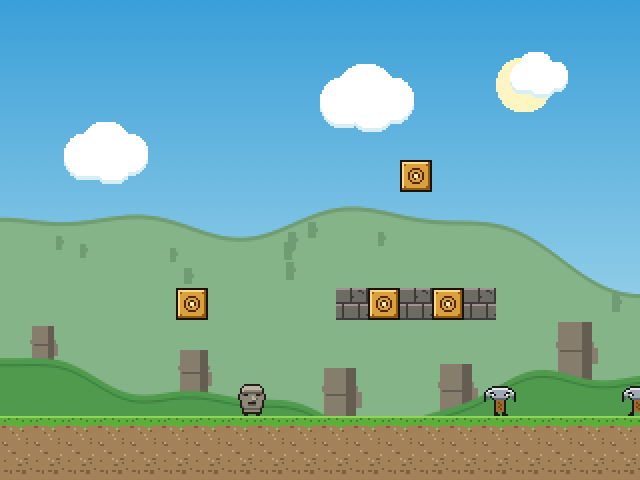
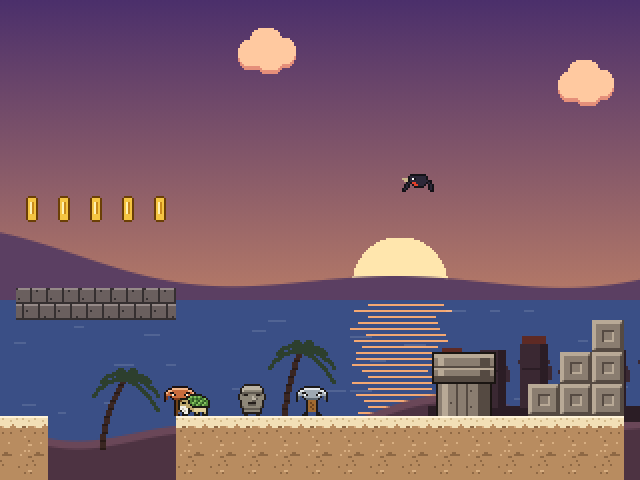
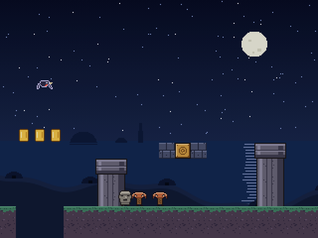
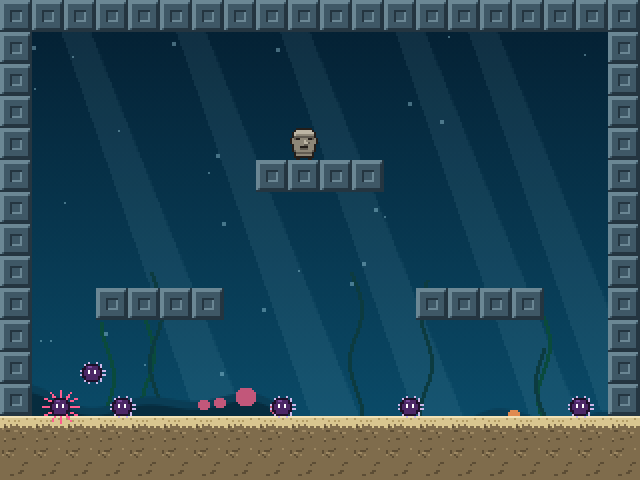

# Aventura do Moai

Jogo de plataforma 2D em pixel art. Mata, o último moai esculpido na pedreira de Rano Raraku, atravessa Rapa Nui até o seu ahu, onde finalmente ganha olhos.

## 📲 Baixar pra Android

### [⬇️ Baixar AventuraDoMoai.apk](https://github.com/MuriloDPV/AventuraDoMoai/releases/latest/download/AventuraDoMoai.apk)

1. Abra o link acima no celular e baixe o arquivo.
2. Toque no arquivo baixado. Se o Android pedir, permita **instalar apps de fontes desconhecidas**.
3. Abra **Aventura do Moai** e jogue deitado.

> O APK é uma versão de teste (assinada com chave de debug), por isso o Android ou o Play Protect podem avisar que o app não é conhecido. Funciona do Android 7 em diante.

Todas as versões ficam em [Releases](https://github.com/MuriloDPV/AventuraDoMoai/releases).

## Outras formas de jogar

- **No navegador:** baixe [`docs/index.html`](docs/index.html) e abra em qualquer navegador, no computador ou no celular.
- **Pelo código:** abra esta pasta no Android Studio (File > Open) e clique em Run.

| Teclado | Celular | Ação |
|---|---|---|
| ← → | ◀ ▶ | andar |
| Espaço / Z | PULO | pular (segure pra ir mais alto) |
| Shift / X | AÇÃO | correr, lançar obsidiana, atirar |
| P · M | Pausa · Som | pausar · ligar/desligar som |

## O jogo

- **3 fases:** Rano Raraku (dia), Anakena (pôr do sol) e Orongo (noite), cada uma terminando num ahu.
- **1 mapa secreto:** um buraco por fase solta bolhas azuis e leva à caverna dos ouriços.
- **Inimigos:** picaretas, makohe (aves arqueiras), Honu (a tartaruga que se divide em duas a cada pisão), ouriços e drones.
- **Itens:** coco (crescer), obsidiana (lascas), escudo de moai (3 golpes) e chapéu russo (metralhadora).
- **Onda de energia:** a cada 3 inimigos derrotados, o próximo que chegar perto cai.
- **Fantasmas:** cada vida perdida vira um fantasma que segue o moai e atrapalha a visão.

| | | |
|---|---|---|
|  |  |  |

## Tecnologia

- **JavaScript, HTML5 e CSS:** o jogo inteiro roda num único arquivo, sem bibliotecas e sem arquivos de imagem ou som. Os sprites são escritos como texto e desenhados num canvas 320×240; a música e os efeitos são gerados com a Web Audio API.
- **Java:** o app Android (`app/`) abre o mesmo jogo numa WebView em tela cheia, deitado. `minSdk` 24, `targetSdk` 35.
- **Gradle (Kotlin DSL):** build do Android.

O arquivo do jogo usado pelo app fica em `app/src/main/assets/index.html` e é idêntico a `docs/index.html`.

## Autor

[MuriloDPV](https://github.com/MuriloDPV)
